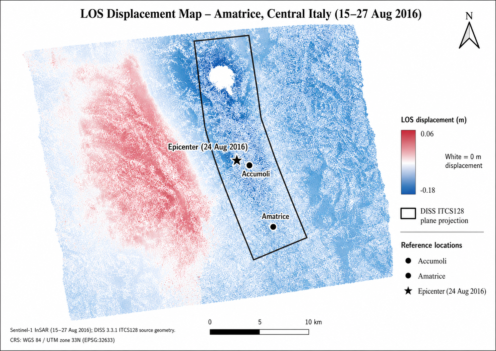

# Sentinel-1 InSAR Earthquake Deformation Mapping: Amatrice 2016

End-to-end Sentinel-1 InSAR workflow for coseismic LOS displacement mapping, quality control, and geospatial validation of the 24 August 2016 Amatrice earthquake in Central Italy.



---

## Project Overview

This project implements an end-to-end Sentinel-1 Interferometric Synthetic Aperture Radar (InSAR) workflow to derive and validate coseismic Line-of-Sight (LOS) displacement associated with the **24 August 2016 Amatrice earthquake** in Central Italy.

Two Sentinel-1A Interferometric Wide Swath (IW) Single Look Complex (SLC) acquisitions from **15 August 2016** and **27 August 2016** were processed using **ESA SNAP** and **SNAPHU**.

The workflow covers the complete processing chain: Sentinel-1 SLC preprocessing and TOPS coregistration, phase unwrapping, displacement generation, coherence-based quality masking, stable-reference correction, terrain correction, GeoTIFF production, cartographic visualization, and independent spatial validation.

The final deformation field was compared with the **DISS 3.3.1 ITCS128 Accumoli–Amatrice Composite Seismogenic Source**, the earthquake epicentral area, and the locations of Amatrice and Accumoli.

---

## Key Result

The analysis produced a geocoded, reference-corrected LOS displacement raster representing the coseismic deformation field associated with the 2016 Amatrice earthquake.

### Final product characteristics

| Parameter | Value |
|---|---|
| Satellite | Sentinel-1A |
| Product | IW SLC |
| Polarization | VV |
| Relative orbit / track | 117 |
| Acquisition dates | 15 Aug 2016 / 27 Aug 2016 |
| Interferometric interval | 12 days |
| Final coherence threshold | γ ≥ 0.40 |
| Output CRS | WGS 84 / UTM Zone 33N |
| EPSG | 32633 |
| Pixel spacing | ~13.89 m |
| Raster dimensions | 3009 × 2852 |
| Output type | Float32 GeoTIFF |
| NoData | -9999 |

### Cartographic visualization range

- Minimum display value: **−0.18 m**
- Neutral value: **0.00 m**
- Maximum display value: **+0.06 m**

White represents approximately zero LOS displacement in the final map.

---

## Processing Workflow

The processing chain implemented in this project is summarized below:

```text
Sentinel-1A IW SLC
        │
        ▼
TOPS Split
        │
        ▼
Precise Orbit Correction
        │
        ▼
Back-Geocoding
        │
        ▼
Enhanced Spectral Diversity (ESD)
        │
        ▼
Interferogram + Coherence
        │
        ▼
TOPS Deburst
        │
        ▼
Topographic Phase Removal
        │
        ▼
Goldstein Phase Filtering
        │
        ▼
Spatial Subset
        │
        ▼
SNAPHU Export
        │
        ▼
Phase Unwrapping
        │
        ▼
SNAPHU Import
        │
        ▼
Phase-to-Displacement
        │
        ▼
Range-Doppler Terrain Correction
        │
        ▼
Coherence Terrain Correction
        │
        ▼
Raster Collocation
        │
        ▼
Coherence Masking (γ ≥ 0.40)
        │
        ▼
Stable-Reference Correction
        │
        ▼
GeoTIFF Export
        │
        ▼
Raster QA/QC
        │
        ▼
QGIS Cartographic Visualization
        │
        ▼
DISS-Based Spatial Validation
```

Detailed technical documentation is available in:

- [Complete Processing Workflow](docs/workflow.md)
- [Methodology](docs/methodology.md)
- [Validation](docs/validation.md)

---

## Sentinel-1 Data

### Acquisition 1

- **Platform:** Sentinel-1A
- **Acquisition date:** 15 August 2016
- **Product type:** IW SLC
- **Polarization:** VV
- **Relative orbit / track:** 117

### Acquisition 2

- **Platform:** Sentinel-1A
- **Acquisition date:** 27 August 2016
- **Product type:** IW SLC
- **Polarization:** VV
- **Relative orbit / track:** 117

The 12-day interferometric pair spans the **24 August 2016 Amatrice earthquake**.

### Auxiliary datasets

- Copernicus DEM GLO-30
- DISS 3.3.1 seismogenic-source database
- Amatrice reference location
- Accumoli reference location
- 24 August 2016 earthquake epicenter

---

## InSAR Processing

### 1. Sentinel-1 TOPS preprocessing

The Sentinel-1 SLC scenes were restricted to:

- Subswath: **IW3**
- Polarization: **VV**
- Study area: **Amatrice–Accumoli**

Precise orbit information was then applied before interferometric coregistration.

### 2. Coregistration

TOPS coregistration was performed using:

- Back-Geocoding
- Copernicus DEM GLO-30
- Enhanced Spectral Diversity (ESD)

This stage provides the geometric alignment required for Sentinel-1 TOPS interferometry.

### 3. Interferogram generation

The coregistered images were used to generate:

- wrapped interferometric phase,
- coherence,
- topographically corrected interferometric products.

Processing included:

- interferogram formation,
- TOPS deburst,
- topographic phase removal,
- Goldstein phase filtering.

### 4. Phase unwrapping

Filtered interferometric phase was exported from SNAP and unwrapped using **SNAPHU 2.0.4**.

The resulting unwrapped phase was imported back into SNAP for displacement generation.

### 5. Phase-to-displacement conversion

The unwrapped interferometric phase was converted to **Line-of-Sight displacement**.

The displacement raster was subsequently terrain-corrected and projected to:

```text
WGS 84 / UTM Zone 33N
EPSG:32633
```

---

## Quality Control

Interferometric coherence was used as the principal quality indicator.

Two coherence thresholds were evaluated:

```text
γ ≥ 0.30
γ ≥ 0.40
```

The **0.40 threshold** was selected for the final product because it provided stronger suppression of low-confidence measurements while retaining the principal coseismic deformation pattern.

The resulting quality mask was applied using the equivalent logic:

```text
coherence >= 0.40 ? displacement : NaN
```

---

## Stable-Reference Correction

A stable reference area located outside the principal deformation lobes was used to remove the residual LOS displacement offset.

### Before correction

Mean displacement within the selected reference area:

```text
+0.0112 m
```

### Correction

```text
corrected_displacement = displacement - 0.0112
```

### After correction

| Statistic | Value |
|---|---:|
| Mean | −1.99 × 10⁻⁵ m |
| Standard deviation | ~0.0050 m |
| Median | −5.81 × 10⁻⁴ m |

The corrected mean is effectively zero, supporting the internal consistency of the reference correction.

---

## Spatial Validation

The final LOS displacement field was compared with the **DISS 3.3.1 Composite Seismogenic Source**:

```text
ITCS128 – Accumoli-Amatrice
```

The validation compared the derived deformation pattern with:

- the modeled ITCS128 source geometry,
- the 24 August 2016 mainshock epicentral area,
- Amatrice,
- Accumoli.

The deformation field shows spatial consistency with the principal coseismic deformation corridor and the modeled Accumoli–Amatrice seismogenic-source geometry.

> **Important:** The DISS source geometry is used here as an independent structural reference. It should not be interpreted as a mapped surface-rupture trace.

---

## Final Raster QA/QC

The final single-band GeoTIFF was verified in QGIS.

### Raster characteristics

| Property | Value |
|---|---|
| Bands | 1 |
| Data type | Float32 |
| CRS | EPSG:32633 |
| Pixel size | ~13.889 m |
| Dimensions | 3009 × 2852 pixels |
| NoData | -9999 |

### Full-raster statistics

| Statistic | Value |
|---|---:|
| Minimum | −0.228492 m |
| Maximum | +0.064816 m |
| Mean | −0.041798 m |
| Standard deviation | 0.047592 m |

These extrema are statistical raster values and are not independently interpreted as representative peak physical deformation without consideration of local coherence, phase quality, and spatial context.

---

## Software & Technologies

This project demonstrates practical use of:

- **Sentinel-1 SAR**
- **Interferometric Synthetic Aperture Radar (InSAR)**
- **ESA SNAP**
- **SNAPHU**
- **QGIS**
- **GDAL**
- **Copernicus DEM GLO-30**
- **DISS 3.3.1**
- **GeoTIFF**
- **GIS**
- **Remote Sensing**
- **Earth Observation**
- **Geospatial Analysis**
- **Raster QA/QC**

---

## Technical Skills Demonstrated

The project demonstrates hands-on experience with:

- Sentinel-1 SLC preprocessing
- Sentinel-1 TOPS interferometry
- precise orbit correction
- TOPS coregistration
- Enhanced Spectral Diversity
- interferogram generation
- coherence assessment
- topographic phase removal
- Goldstein phase filtering
- SNAPHU phase unwrapping
- phase-to-displacement conversion
- Range-Doppler terrain correction
- raster collocation
- coherence-based quality masking
- stable-reference correction
- raster QA/QC
- GeoTIFF production
- QGIS cartographic visualization
- independent geospatial validation
- scientific geospatial communication

---

## Repository Structure

```text
sentinel1-insar-amatrice-2016/
│
├── README.md
├── LICENSE
├── .gitignore
│
├── docs/
│   ├── methodology.md
│   ├── validation.md
│   └── workflow.md
│
├── figures/
│   └── final/
│       └── amatrice_insar_los_displacement_validation.png
│
├── data/
│   ├── input/
│   │   └── .gitkeep
│   └── derived/
│       └── .gitkeep
│
└── metadata/
    └── project_metadata.csv
```

---

## Data Availability

Raw Sentinel-1 SLC scenes and large intermediate SAR products are **not stored in this repository** because of their size.

The repository focuses on:

- processing methodology,
- reproducible workflow documentation,
- QA/QC procedures,
- validation methodology,
- metadata,
- derived figures,
- final cartographic outputs.

Original Sentinel-1 data should be obtained directly from official Copernicus data services when reproducing the workflow.

---

## Reproducibility

The repository documents the major processing parameters and methodological decisions required to reproduce the analysis.

Large SAR source products and intermediate processing files are intentionally excluded from version control.

Additional processing documentation is provided under [`docs/`](docs/).

Structured project parameters and output specifications are available in [`metadata/project_metadata.csv`](metadata/project_metadata.csv).

---

## Project Scope

This project was developed as a technical Earth Observation and geospatial analysis case study focused on:

- satellite radar interferometry,
- earthquake deformation mapping,
- scientific raster processing,
- quality-controlled geospatial analysis,
- validation against an independent seismogenic-source dataset.

---

## Author

**Maryam Ghaderian**

Geospatial Analysis · GIS · Remote Sensing · Earth Observation · Environmental Engineering
